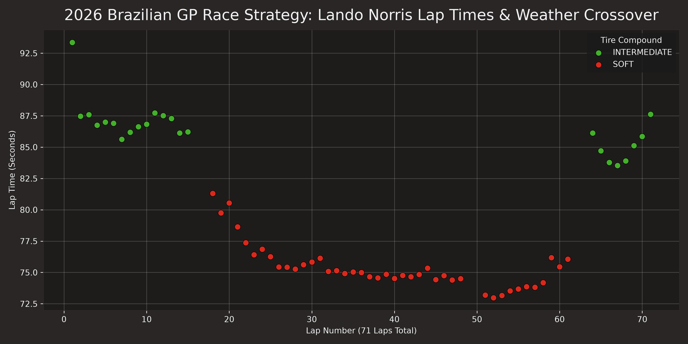
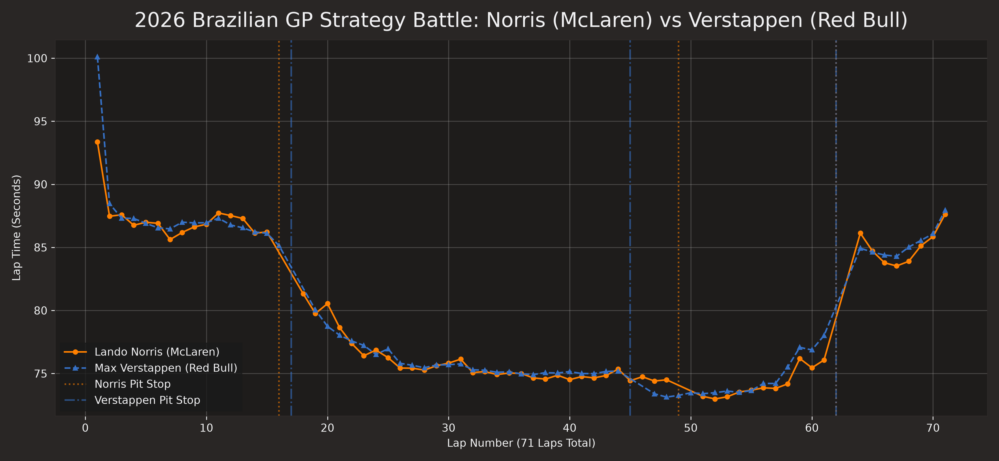

# Formula 1 Telemetry & Race Strategy Analysis (Python + FastF1)

A collection of Python data analysis scripts using official FIA timing and telemetry data (`FastF1`, `Pandas`, `Matplotlib`) to study tire degradation, pit-stop strategy, and driver telemetry.

## 1. 2026 Brazilian GP: Wet-to-Dry Tire Strategy (Lando Norris)

* **Key Insight:** Tracks Lando Norris's lap times across mixed weather conditions at Interlagos, highlighting the exact wet-to-slick crossover around Lap 17, thermal tire degradation on Soft slicks, and the late-race return to Intermediates around Lap 62.

## 2. McLaren vs. Red Bull Pit-Stop Comparison

* **Key Insight:** Compares race pace and pit-stop timing between Lando Norris and Max Verstappen to analyze undercut/overcut windows.

## Tools Used
* **Python 3.14**, **FastF1**, **Matplotlib**, **Pandas**
